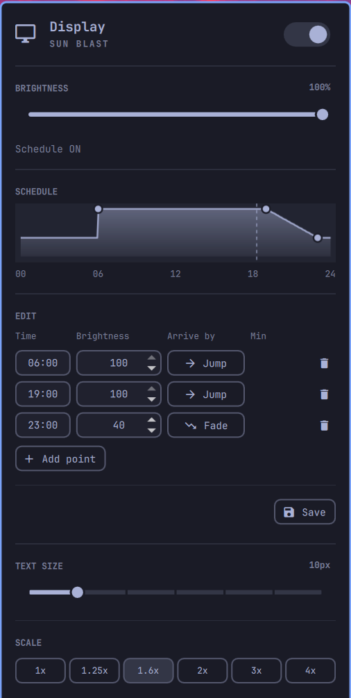

# Display + Brightness Schedule for Omarchy

Omarchy's Display panel with a 24-hour **brightness schedule** added, so the screen can dim as you work later into the night. Every stock setting is kept: brightness, text size, scale and monitors. It replaces the built-in `omarchy.monitor`.



## Features

- **Schedule switch** in the panel header turns the schedule on or off, and is remembered across reboots. With it off, the panel behaves exactly like the stock one.
- **Timeline and editor** work the same as the [Night Light Schedule](https://github.com/Albertus-de-Klerk/omarchy-nightlight-schedule) plugin:
  - Add as many points as you like; each one *arrives* by **Jump**, **Fade** (1% steps) or **Steps** every *N* minutes.
  - **Edit** opens the editor and turns into **Save** in the same spot.
- **Manual changes win until the next point.** This applies to the slider, the bar-icon scroll wheel and the brightness keys. A *Resume schedule* button returns control early.
- The schedule drives the built-in panel (eDP/LVDS/DSI), or the focused monitor if there is no built-in one.

The default schedule (off until you switch it on) is 100% until 19:00, then a fade to 40% by 23:00 that holds until 06:00.

## Install

```bash
omarchy plugin add https://github.com/Albertus-de-Klerk/omarchy-display-brightness-schedule.git --enable
omarchy plugin disable omarchy.monitor
omarchy restart shell
```

## Command line

```bash
omarchy-shell brightness-schedule status   # JSON: enabled, brightness, scheduled, override
omarchy-shell brightness-schedule enable|disable|toggle
omarchy-shell brightness-schedule set 60   # hold 60% until the next point
omarchy-shell brightness-schedule resume
```

Settings are stored in `~/.config/omarchy/brightness-schedule.json` and apply live when edited by hand.

## Requirements

Omarchy 4.5+ and a display whose brightness `omarchy brightness display` can set. Tested on Omarchy 4.5.0.

## Development

`node tests/schedule.test.js` runs the schedule maths tests.

## Remove

```bash
omarchy plugin remove albertus.monitor
omarchy plugin enable omarchy.monitor
omarchy restart shell
```
